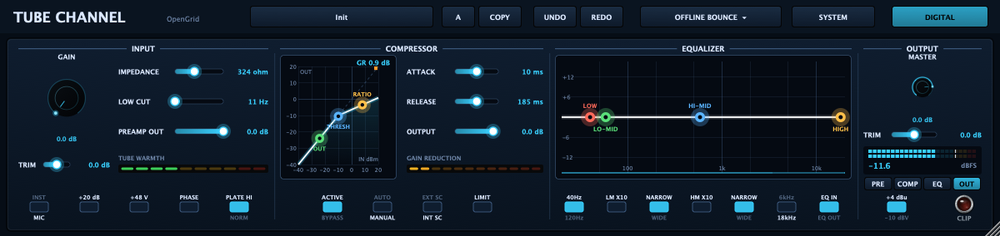
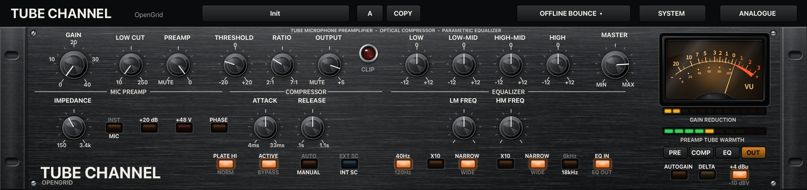
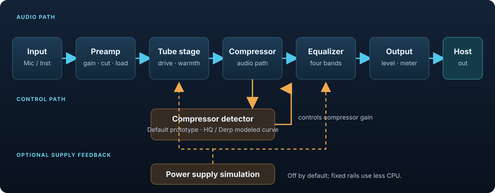

# Tube Channel

**A circuit-modelled channel strip for Windows, macOS, and desktop audio workstations.** Tube Channel combines a preamp, compressor, four-band equalizer, output stage, and optional power-supply simulation in one plug-in.



The interface is available in a digital layout and an analogue-style layout. Both control the same audio model.

| Digital | Analogue-style |
|---|---|
|  |  |

## Version 2.0.0 (in preparation)

**2.0.0** moves Tube Channel from JUCE to [OpenPluginSDK](https://github.com/MistaMin/OpenPluginSDK), with the editor drawn by GoodLookin DRI. The audio model is the same code as 1.2.x.

- Projects and presets saved with 1.x open with the same settings. At the default settings the output is bit-identical to the 1.2.5 build (VST3, 48 kHz).
- New: **Autogain** (loudness-matched output) and **Delta** (hear only what the processing changes), both off by default.
- Engine, oversampling and phase changes are built in the background and faded in.
- An offline render always starts with the circuit at rest, so repeated bounces match.
- Removed: the plug-in's own undo history, the CPU readout and the standalone app.

2.0.0 is not published yet. The downloads below are 1.2.4, the current release. See the [2.0.0 release notes](docs/RELEASE_2.0.0.md) and the [changelog](CHANGELOG.md).

## Download

Pick the download for your operating system. The macOS installer includes VST3,
Audio Unit, CLAP, LV2, and AAX. The Windows build includes
VST3, CLAP, and LV2; the Linux build adds the standalone app.

**Windows 1.2.4 (Windows 10 or later, x64)** — [Tube-Channel-1.2.4-windows-x64-bundles.zip](https://github.com/MistaMin/TubeChannel/releases/download/v1.2.4/Tube-Channel-1.2.4-windows-x64-bundles.zip) ([SHA-256](https://github.com/MistaMin/TubeChannel/releases/download/v1.2.4/Tube-Channel-1.2.4-windows-x64-bundles.zip.sha256))
There is no installer for Windows yet. Extract the zip and copy `Common Files\VST3\Tube Channel.vst3`, `Common Files\CLAP\Tube Channel.clap` and `Common Files\LV2\Tube Channel.lv2` into `C:\Program Files\Common Files\VST3`, `...\CLAP` and `...\LV2`.

**macOS 1.2.4 (Apple silicon and Intel)** — [TubeChannel-1.2.4-macos.pkg](https://github.com/MistaMin/TubeChannel/releases/download/v1.2.4/TubeChannel-1.2.4-macos.pkg) ([SHA-256](https://github.com/MistaMin/TubeChannel/releases/download/v1.2.4/TubeChannel-1.2.4-macos.sha256))
Signed and notarized. The installer lets you choose VST3, Audio Unit, CLAP, LV2,
and AAX.

**Linux 1.2.4 (x86_64)** — [TubeChannel-1.2.4-linux-x86_64.tar.gz](https://github.com/MistaMin/TubeChannel/releases/download/v1.2.4/TubeChannel-1.2.4-linux-x86_64.tar.gz) ([SHA-256](https://github.com/MistaMin/TubeChannel/releases/download/v1.2.4/TubeChannel-1.2.4-linux-x86_64.tar.gz.sha256))
Includes **VST3**, **CLAP**, **LV2**, and the **standalone app**. Extract the archive and copy the contents of `VST3/`, `CLAP/`, and `LV2/` into `~/.vst3`, `~/.clap`, and `~/.lv2`.

All packages include the user guide and applicable license texts. Browse all downloads
on [GitHub Releases](https://github.com/MistaMin/TubeChannel/releases). See the
[1.2.4 release notes](docs/RELEASE_1.2.4.md).

> **Windows may show a security prompt.** Because the Windows installer is not yet code-signed, Windows SmartScreen might show a blue "Windows protected your PC" message the first time you run it. The file is safe — click **More info**, then **Run anyway**. (See the note about code signing below.)

## User guide

See the [Tube Channel User Guide](docs/USER_MANUAL.md) for the complete control reference, signal-flow diagrams, quality-mode details, and setup notes. It describes 2.0; the [changelog](CHANGELOG.md) lists what each version changed.

For engineering teams, the [HQ-to-Eco engineering guide](docs/HQ_TO_ECO_ENGINEERING_GUIDE.md) documents the model-reduction process, measurement pipeline, validation, compatibility work and reusable project handoff.

## Modes and oversampling

The System page has three engine buttons, in this order: **Eco**, **Circuit**, **HQ**.
Eco is the new-instance default and uses the reduced engine. Circuit is the renamed
Default mode with its prototype detector; HQ uses the original modeled detector.
The original circuit code remains available in Circuit and HQ.

Three separate small buttons select **2x**, **4x**, or **8x** (the Derp symbol).
Oversampling applies independently to every engine at every session rate. Clicking
the selected oversampling button returns to **1x**, shown with no button lit.
New instances start at 1x to retain Eco's low CPU cost. **+L LINEAR** chooses
linear-phase filters and reports their latency when oversampling is active;
minimum-phase filtering reports zero latency.

Older saved states retain their previous adaptive oversampling and quality mapping.
The first engine click freezes their current factor as an independent setting.
The legacy Quality automation parameter retains its three-value range; the new
Oversampling parameter is appended after the existing parameters.

Eco approximates the stages with calibrated filters, nonlinear maps, the retained
optical response, and reduced supply/load states. Heavy-drive harmonics and aliasing
differ; Eco is not circuit-identical. Oversampling increases CPU cost; the published
Eco measurements use its 1x default. PSU SIM is off for new instances.

## Audio model

In Circuit and HQ, the audio path is solved sample by sample at the selected oversampling rate. Eco uses fixed-cost filter and nonlinear stages. The detector is mode-selected and runs at the session rate. The supply model can feed changing rails back into the audio stages when enabled.



Stereo processing uses a lockstep circuit pair. Tests compare it with two independent channels to better than -125 dB. The circuit netlists are embedded at build time.

## Performance

Earlier development measurements on an Apple M1 Max at 48 kHz, 2x, 256-sample blocks, with circuit noise and component tolerances on, processing a -18 dBFS sine:

| Configuration | Measured real-time CPU |
|---|---:|
| Mono, supply simulation on | about 35% |
| Mono, supply simulation off | about 30% |
| Stereo, supply simulation on | about 70% |
| Stereo, supply simulation off | about 60% |

These measurements predate the current quality-mode mapping and came from a machine that was not idle; use them as historical reference only. Actual results vary by host, session settings, and computer. The supply simulation is off by default for new instances.

## Build from source

The plug-in is the Rust crate in [`plugin/`](plugin/README.md). It compiles the circuit code in `Source/` (C++, no framework) behind a C interface. You need Rust, a C++ compiler, and a checkout of OpenPluginSDK at the revision `plugin/Cargo.toml` pins for its bundle scripts.

```sh
cd plugin
cargo test --release
scripts/build.sh --archs universal --out dist   # CLAP, LV2, VST3, Audio Unit, AAX; nothing is installed or signed
```

VST3, Audio Unit and AAX need their SDKs (`VST3_SDK`, `AU_SDK`, `AAX_SDK`, or a `Dependencies` folder beside the repository). AAX also needs a separately licensed AAX SDK and PACE signing access. `scripts/build.sh --qa` builds a test copy with its own ids that installs beside a release.

The JUCE project in the repository root (`CMakeLists.txt`, `Source/Plugin`, `Source/UI`) is what 1.2.x was built from. It is kept as the reference for the port and is no longer developed.

## Repository layout

| Folder | What it holds |
|---|---|
| `plugin/` | The 2.0 plug-in: parameters, state, editor, tests, build script |
| `Source/` | The circuit, channel, hybrid (Eco) and oversampling code both builds share; the 1.2.x JUCE plug-in and editor |
| `Netlists/` | The circuit netlists, embedded at build time |
| `docs/` | User guide, release notes, engineering notes, measurements |
| `tests/`, `tools/`, `installer/` | The 1.2.x tests, fitting and packaging tools |
| `qa/` | Test evidence per run |

## License

Tube Channel source code is MIT licensed, copyright Marcos Quirino Deida; see [LICENSE](LICENSE). All official plugin binaries, including the macOS AAX binary, are freeware under [BINARY_LICENSE.txt](BINARY_LICENSE.txt). The package includes the applicable third-party license texts. See [THIRD_PARTY_LICENSES.md](THIRD_PARTY_LICENSES.md) for the dependency list and build requirements.

VST is a registered trademark of Steinberg Media Technologies GmbH. Audio Units is a trademark of Apple Inc. AAX and Pro Tools are trademarks of Avid Technology, Inc.
