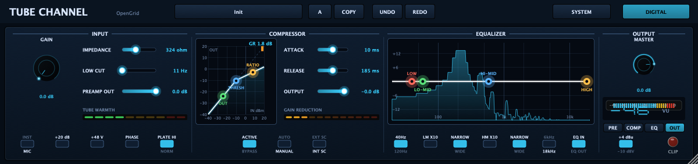
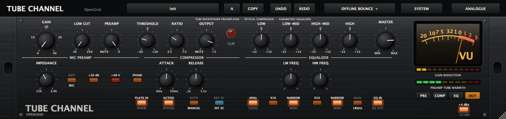
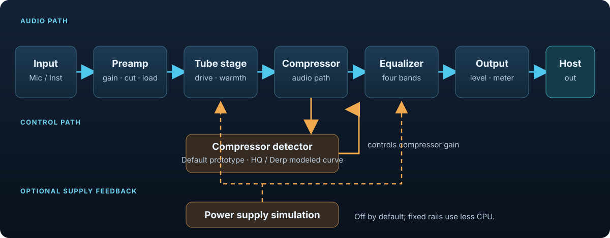

# Tube Channel

**A circuit-modelled channel strip for Windows, macOS, and desktop audio workstations.** Tube Channel combines a preamp, compressor, four-band equalizer, output stage, and optional power-supply simulation in one plug-in.



The interface is available in a digital layout and an analogue-style layout. Both control the same audio model.

| Digital | Analogue-style |
|---|---|
|  |  |

## Version 1.2.3

**1.2.3** adds a dedicated icon for the standalone app and fixes the Linux GUI
test setup so menu tests run with a native X11 window. The audio processing is
unchanged from 1.2.2.

**1.2.1** adds an **Offline Bounce** dropdown between Redo and System. Choose any
of nine combinations: Eco, Circuit or HQ at 2x, 4x or Derp (8x). New instances use
Eco/1x for playback and HQ/8x only when the host reports offline rendering.
Playback, recording and realtime exports keep the normal System-page settings.
Older saved projects retain their previous bounce behavior until a dropdown choice
is made. See the [1.2.1 release notes](docs/RELEASE_1.2.1.md).

**1.2.0** adds the reduced **Eco** engine as the default for new instances.
It uses measured filters and asymmetric nonlinear maps without runtime circuit solves.
Circuit and HQ retain the original engine. Older sessions, including legacy Derp
settings, retain their original processing.

The measured stereo workload matrix achieved **26–35x at 48 kHz** and **14–19x at
96 kHz** against v1.1.4 Default, exceeding the 10x minimum throughout. The 20x
stretch target is met at 48 kHz. These are local measured results; they do not establish listening acceptance
or actual multi-instance DAW playback. See the [measurement report](docs/measurements/eco-1.2.0/README.md)
and [development plan](docs/SOUND_MODEL_PLAN.md).

## Download

Pick the download for your operating system. The macOS installer includes VST3,
Audio Unit, CLAP, LV2, standalone, and AAX. Windows and Linux builds
include VST3, CLAP, LV2, and standalone.

**Windows 1.2.3 (Windows 10 or later, x64)** — [TubeChannel-1.2.3-win.exe](https://github.com/MistaMin/TubeChannel/releases/download/v1.2.3/TubeChannel-1.2.3-win.exe)
Double-click the installer and choose which formats to install: **VST3** and **CLAP** for most recording apps, **LV2**, and the **standalone app** (run it on its own, no other software needed).

**macOS 1.2.3 (Apple silicon and Intel)** — [TubeChannel-1.2.3.pkg](https://github.com/MistaMin/TubeChannel/releases/download/v1.2.3/TubeChannel-1.2.3.pkg) · [TubeChannel-1.2.3.dmg](https://github.com/MistaMin/TubeChannel/releases/download/v1.2.3/TubeChannel-1.2.3.dmg)
Signed and notarized. The installer lets you choose VST3, Audio Unit, CLAP, LV2,
AAX, and the standalone app.

**Linux 1.2.3 (x86_64)** — [TubeChannel-1.2.3-linux-x86_64.tar.gz](https://github.com/MistaMin/TubeChannel/releases/download/v1.2.3/TubeChannel-1.2.3-linux-x86_64.tar.gz) ([SHA-256](https://github.com/MistaMin/TubeChannel/releases/download/v1.2.3/TubeChannel-1.2.3-linux-x86_64.sha256))
Includes **VST3**, **CLAP**, **LV2**, and the **standalone app**. Extract the archive and copy the contents of `VST3/`, `CLAP/`, and `LV2/` into `~/.vst3`, `~/.clap`, and `~/.lv2`.

All packages include the user guide and applicable license texts. Browse all downloads
on [GitHub Releases](https://github.com/MistaMin/TubeChannel/releases). See the
[1.2.3 release notes](docs/RELEASE_1.2.3.md).

> **Windows may show a security prompt.** Because the Windows installer is not yet code-signed, Windows SmartScreen might show a blue "Windows protected your PC" message the first time you run it. The file is safe — click **More info**, then **Run anyway**. (See the note about code signing below.)

## User guide

See the [Tube Channel User Guide](docs/USER_MANUAL.md) for the complete control reference, signal-flow diagrams, quality-mode details, and setup notes.

For engineering teams, the [HQ-to-Eco engineering guide](docs/HQ_TO_ECO_ENGINEERING_GUIDE.md) documents the model-reduction process, measurement pipeline, validation, compatibility work and reusable project handoff.

## Modes and oversampling

The System page has three engine buttons, in this order: **Eco**, **Circuit**, **HQ**.
Eco is the new-instance default and uses the reduced engine. Circuit is the renamed
Default mode with its prototype detector; HQ uses the original modeled detector.
The original circuit code remains available in Circuit and HQ.

Three separate small buttons select **2x**, **4x**, or **8x** (the Derp symbol).
Oversampling applies independently to every engine at every session rate. Clicking
the selected oversampling button returns to **1x**, shown with no button lit.
New instances start at 1x to retain Eco's low CPU cost. **+L LINEAR** chooses
linear-phase filters and reports their latency when oversampling is active;
minimum-phase filtering reports zero latency.

Older saved states retain their previous adaptive oversampling and quality mapping.
The first engine click freezes their current factor as an independent setting.
The legacy Quality automation parameter retains its three-value range; the new
Oversampling parameter is appended after the existing parameters.

Eco approximates the stages with calibrated filters, nonlinear maps, the retained
optical response, and reduced supply/load states. Heavy-drive harmonics and aliasing
differ; Eco is not circuit-identical. Oversampling increases CPU cost; the published
Eco measurements use its 1x default. PSU SIM is off for new instances.

## Audio model

In Circuit and HQ, the audio path is solved sample by sample at the selected oversampling rate. Eco uses fixed-cost filter and nonlinear stages. The detector is mode-selected and runs at the session rate. The supply model can feed changing rails back into the audio stages when enabled.



Stereo processing uses a lockstep circuit pair. Tests compare it with two independent channels to better than -125 dB. The circuit netlists are embedded at build time.

## Performance

Earlier development measurements on an Apple M1 Max at 48 kHz, 2x, 256-sample blocks, with circuit noise and component tolerances on, processing a -18 dBFS sine:

| Configuration | Measured real-time CPU |
|---|---:|
| Mono, supply simulation on | about 35% |
| Mono, supply simulation off | about 30% |
| Stereo, supply simulation on | about 70% |
| Stereo, supply simulation off | about 60% |

These measurements predate the current quality-mode mapping and came from a machine that was not idle; use them as historical reference only. Actual results vary by host, session settings, and computer. The supply simulation is off by default for new instances.

## Build from source

**macOS / Linux**

```sh
git submodule update --init
cmake -S . -B build -G Ninja -DCMAKE_BUILD_TYPE=Release
cmake --build build
ctest --test-dir build --output-on-failure
```

**Windows**

From a command prompt after running the Visual Studio x64 tools (`vcvars64.bat`):

```bat
git submodule update --init
cmake -S . -B build -G Ninja -DCMAKE_BUILD_TYPE=Release
cmake --build build
ctest --test-dir build --output-on-failure
```

Or use the convenience wrapper once the x64 tools are active:

```bat
build_win.bat configure
build_win.bat build
build_win.bat test
```

To package the installer you also need [Inno Setup](https://jrsoftware.org/isinfo.php). Then run:

```powershell
powershell -ExecutionPolicy Bypass -File installer\build_installer_win.ps1
```

The build produces VST3, Standalone, LV2, and CLAP; Audio Unit is also built on macOS. AAX can be enabled when its SDK is available, but it is not part of the public release package. On macOS, pass `-DTUBECHANNEL_UNIVERSAL=ON` for an arm64 + x86_64 build. Existing JUCE and CLAP extension checkouts can be supplied with `-DTUBECHANNEL_JUCE_SOURCE=<path>` and `-DTUBECHANNEL_CLAP_EXT_SOURCE=<path>`. A Windows installer script (`installer/TubeChannel.iss`) and build script (`installer/build_installer_win.ps1`) are included for the Windows distribution.

## Notes for Windows users

- **SmartScreen warning.** The installer is not code-signed, so Windows may show a "Windows protected your PC" dialog the first time it runs. Click **More info** → **Run anyway**. Code signing requires a Windows code-signing certificate and a `signtool.exe` step after the installer is built; that step is not included here.

## License

Tube Channel source code is MIT licensed; see [LICENSE](LICENSE). The provided plugin binaries are freeware. The package includes the applicable third-party license texts. See [THIRD_PARTY_LICENSES.md](THIRD_PARTY_LICENSES.md) for the dependency list and build requirements. Building from source requires a JUCE license that covers your use and distribution.
