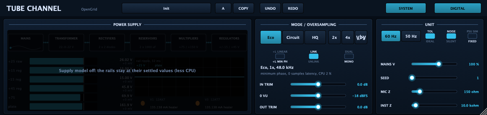
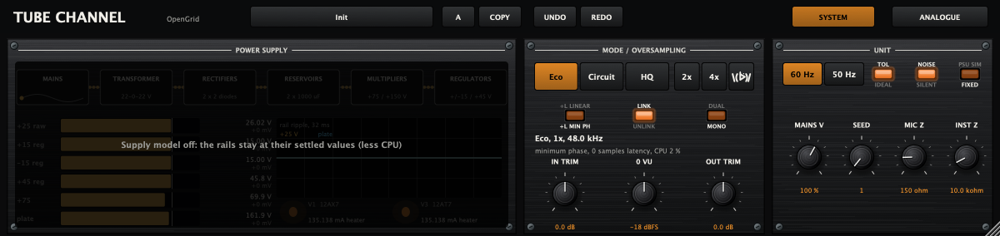

# Tube Channel User Guide

Tube Channel is a channel-strip plug-in with an input/preamp section, a compressor, a four-band equalizer, and an output section. Its analogue-style and digital skins share the same controls and sound. The System page contains quality, stereo, and circuit settings.

## Main page

### Toolbar

| Control | What it does |
|---|---|
| **Init** | Opens the factory-preset menu. Init restores the starting settings; the other entries are starting points for vocals, bass, drums, tube drive, and limiting. |
| **A / B** | Switches between two parameter snapshots. |
| **Copy** | Copies the current snapshot to the other snapshot. |
| **Undo / Redo** | Reverses or reapplies the last control changes. |
| **CH A / CH B** | Selects the channel controls when Dual Mono is enabled. These tabs are hidden otherwise. |
| **System** | Opens the System page. Press it again to return to the main page. |
| **Analogue / Digital** | Changes the interface layout. It does not change the audio processing. |

### Input and preamp

| Control | What it does |
|---|---|
| **Mic / Inst** | Chooses the microphone or instrument input path. |
| **Gain** | Sets input gain. The range is approximately 0 to 40.6 dB. |
| **+20 dB** | Adds an additional 20 dB of input gain. |
| **+48 V** | Turns phantom power on or off. Use it only when the connected microphone requires it. |
| **Phase** | Reverses signal polarity. |
| **Impedance** | Sets the input load from 150 ohms to approximately 3.4 kilohms. |
| **Low Cut** | Sets the low-frequency cut from approximately 11 Hz to 250 Hz. |
| **Preamp / Preamp Out** | Sets the level leaving the preamp; the control can mute the preamp output. |
| **Plate Hi / Norm** | Selects the higher or normal internal tube supply setting. |
| **Input Trim** *(System page)* | Adds or removes up to 24 dB before the channel processing. |

### Compressor

| Control | What it does |
|---|---|
| **Active / Bypass** | Enables or bypasses the compressor. |
| **Threshold** | Sets the compressor threshold, displayed in dBm. |
| **Ratio** | Sets the labelled ratio from 2:1 to 7:1. Click the Ratio control to switch the brickwall limiter on or off. |
| **Attack** | Sets how quickly compression responds, from about 4 ms to 33 ms. |
| **Release** | Sets how quickly gain reduction recovers, from about 0.1 s to 1.1 s. |
| **Auto / Manual** | Selects automatic or manual detector timing. |
| **Int SC / Ext SC** | Selects the internal detector signal or the host's external sidechain input. The host must provide a sidechain bus for Ext SC. |
| **Output** | Sets compressor make-up/output level. |
| **Gain Reduction meter** | Shows the compressor's current gain reduction. |

### Equalizer

| Control | What it does |
|---|---|
| **EQ In / EQ Out** | Enables or bypasses the equalizer. |
| **Low** | Boosts or cuts the low shelf, up to 12 dB in either direction. **40 Hz / 120 Hz** selects its frequency. |
| **Low-Mid** | Sets the low-mid band's boost or cut. **LM Freq** sets its centre frequency; **LM X10** selects the higher frequency range; **Narrow / Wide** changes its bandwidth. |
| **High-Mid** | Sets the high-mid band's boost or cut. **HM Freq**, **HM X10**, and **Narrow / Wide** set its centre frequency, range, and bandwidth. |
| **High** | Boosts or cuts the high shelf, up to 12 dB in either direction. **6 kHz / 18 kHz** selects its frequency. |

### Output and meters

| Control | What it does |
|---|---|
| **Master** | Sets the final output level. |
| **Output Trim** *(System page)* | Adds or removes up to 24 dB after the channel processing. |
| **+4 dBu / -10 dBV** | Selects the nominal output and meter reference level. |
| **PRE / COMP / EQ / OUT** | Selects the point in the signal path shown by the VU meter. |
| **VU meter** | Displays the selected signal level. The clip lamp indicates output clipping. |
| **Preamp Tube Warmth meter** | Shows the tube-stage drive activity. |

## System page

### Modes, oversampling and stereo

The engine buttons are ordered **Eco · Circuit · HQ**.

| Control | What it does |
|---|---|
| **Eco** | New-instance default. Uses calibrated filters and nonlinear maps, residual ADAA and no circuit solves. Heavy-drive behavior can differ from Circuit/HQ. |
| **Circuit** | Renamed Default mode. Retains the circuit audio stages and prototype compressor detector. |
| **HQ** | Retains the circuit audio stages and original modeled compressor detector. |
| **2x / 4x / Derp symbol** | Independent oversampling at exactly 2x, 4x or 8x, at any session rate and with any engine. Click the lit button again to switch off (1x, no button lit). New instances start at 1x. |
| **+L Min Ph / +L Linear** | Chooses minimum-phase IIR or linear-phase FIR oversampling filters. Linear phase reports latency when oversampling is active. |
| **Link / Unlink** | Links or separates the left and right channel controls. |
| **Mono / Dual** | Selects a single linked stereo path or independent Dual Mono channel settings. In Dual Mono, use CH A and CH B to edit each side. |

The status text reports the engine, effective factor/internal sample rate, phase,
latency and CPU use. Oversampling increases CPU cost; Eco's published speed results
use 1x. Eco uses reduced supply/load states and seeded gain/noise variation rather
than per-component circuit-equivalent behavior.

The existing three-choice Quality automation range is preserved. Eco and independent
Oversampling have separate automation parameters. Loading a pre-Eco state keeps Eco
off. Loading a state from before the independent oversampling control preserves its
previous adaptive factor; the first engine click freezes that factor, so subsequent
mode changes keep oversampling unchanged.

### Unit and power supply

| Control | What it does |
|---|---|
| **60 Hz / 50 Hz** | Selects the modeled mains frequency. |
| **TOL / IDEAL** | Enables per-unit component tolerances or uses ideal nominal values. |
| **NOISE / SILENT** | Enables or disables circuit noise. |
| **PSU SIM / FIXED** | Enables the power-supply circuit simulation or holds its rails at settled values. New instances start with PSU SIM off to save CPU. A saved session restores its saved setting. |
| **Mains V** | Sets the modeled mains voltage from 85% to 110%. |
| **Seed** | Selects a repeatable component-tolerance/noise seed. |
| **Mic Z** | Sets the modeled microphone source impedance from 50 to 600 ohms. |
| **Inst Z** | Sets the modeled instrument source impedance from 1 to 100 kilohms. |
| **Power Supply display** | Shows the modeled supply rails and their ripple when PSU SIM is enabled. |

### Level alignment

| Control | What it does |
|---|---|
| **In Trim** | Sets input trim from -24 to +24 dB. |
| **0 VU** | Chooses the digital level that corresponds to 0 VU: -14, -16, -18, -20, or -22 dBFS. |
| **Out Trim** | Sets output trim from -24 to +24 dB. |

## Signal flow

The main audio moves through the channel in this order. The detector listens to the selected internal or external sidechain and controls compressor gain reduction. The supply simulation, when enabled, calculates changing supply rails that can affect the circuit stages.

## Notes

- The plugin's first/default state has PSU SIM off. Turning it on uses more CPU.
- In a saved project, the host-restored parameter value takes precedence over the new-instance default.
- If you hear crackling or breakup, first check the host's audio buffer and real-time CPU load, then try Eco mode and turn off PSU SIM.
- Source code is MIT licensed. The installer includes the applicable third-party license texts. See [LICENSE](../LICENSE) and [THIRD_PARTY_LICENSES.md](../THIRD_PARTY_LICENSES.md).
