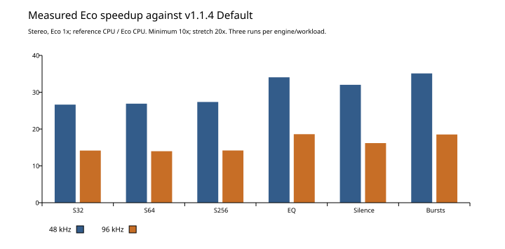
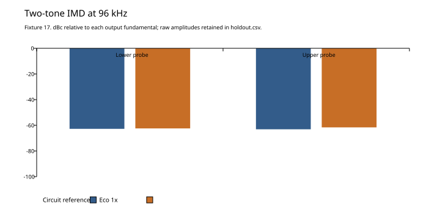

# Eco 1.2.0 — local implementation and measurements

Eco is the default for new instances. The current UI orders the engines Eco,
Circuit (renamed Default), HQ. Circuit/HQ and legacy Derp retain the circuit engine. Eco performs no runtime circuit solves, even
during preparation. It uses measured stable filters, asymmetric piecewise-linear
nonlinear maps with residual first-order ADAA, a retained optical response, a 12 kHz
detector, and an 8 kHz reduced supply model. It defaults to the session rate and zero latency. Independent 2x/4x/8x
oversampling and linear-phase filtering are available with every engine. The timing
results below are from Eco at 1x before this UI separation. The 1x fast path is
retained; no new performance claim is made for the oversampled Eco settings.

## Compatibility and verification

The reference is v1.1.4 source `a80455549b9b92466f73d9017b8127fad779f013`.
The original three modes match the saved reference byte-for-byte over 491,520 float
samples covering two rates and gain, plate, bypass, timing, Auto, noise and tolerance
settings. Existing Quality retains its three choices and normalized automation
mapping. The new `ecomode` boolean is appended after every original parameter with
AU version hint 2; old state XML lacking it explicitly restores Eco off.

The complete native suite passed 14/14; after final DSP changes the affected
Eco, quality and real-time suites passed 3/3. Final JUCE processor/state and GUI
suites passed 2/2. Checks cover callback allocation/free, finite output, extremes,
silence tails, exact buffer-partition independence, live mode changes, new defaults,
legacy automation/state, external sidechain, stereo link and Dual Mono. Tests do
not replace listening or DAW playback.

At the measurement checkpoint, Release-configuration arm64 VST3, AU, CLAP, LV2 and Standalone targets built locally
under `build/juce/TubeChannel_artefacts/Release`. No installed plugin was replaced;
packaging had not yet been performed. The subsequent [1.2.0 release verification](../release-1.2.0/README.md) records universal builds, signing and notarization.

## Performance

Native comparison uses the pinned reference with the same extended measurement
harness, Release optimization, two channels, noise/tolerances enabled, matched
controls, seed, rate and duration. Each case has 0.5 s warmup and 1 s measurement,
three runs per engine in alternating R/E/E/R/R/E order. Builds and analyzers were
stopped during measurement. Speedup is mean reference process CPU / mean Eco CPU.
Reference mode is Default; Eco is mode 3. This is a measured workload matrix, not
a guarantee for every platform or sample rate.

| Rate | Buffer | Input/workload | Reference ms | Eco ms | Speedup |
|---|---:|---|---:|---:|---:|
| 48 kHz | 32 | Ordinary sine | 0.2930 | 0.0110 | 26.64x |
| 48 kHz | 64 | Ordinary sine | 0.5917 | 0.0220 | 26.89x |
| 48 kHz | 256 | Ordinary sine | 2.3253 | 0.0850 | 27.36x |
| 48 kHz | 32 | Full scale + EQ automation + PSU | 0.4087 | 0.0120 | 34.06x |
| 48 kHz | 64 | Silence | 0.5763 | 0.0180 | 32.02x |
| 48 kHz | 256 | Full-scale bursts + PSU | 2.7620 | 0.0787 | 35.11x |
| 96 kHz | 32 | Ordinary sine | 0.1463 | 0.0103 | 14.16x |
| 96 kHz | 64 | Ordinary sine | 0.2937 | 0.0210 | 13.98x |
| 96 kHz | 256 | Ordinary sine | 1.1490 | 0.0810 | 14.19x |
| 96 kHz | 32 | Full scale + EQ automation + PSU | 0.2047 | 0.0110 | 18.61x |
| 96 kHz | 64 | Silence | 0.2913 | 0.0180 | 16.19x |
| 96 kHz | 256 | Full-scale bursts + PSU | 1.3710 | 0.0740 | 18.53x |

**Every case exceeds 10x.** 48 kHz reaches the 20x stretch goal; 96 kHz does not.
Raw per-run callback tails, deadline misses, finite checks and CPU values are in
[`benchmark/`](benchmark/) and [`benchmark.txt`](benchmark.txt).

The full JUCE processor harness runs 16 serial instances, including parameter
reads, meters and spectrum work, for 256 measured callbacks per case:

| Rate | Buffer | Reference ms / callback | Eco ms / callback | Eco worst ms | Eco misses |
|---|---:|---:|---:|---:|---:|
| 48 kHz | 32 | 4.821480 | 0.182566 | 0.201542 | 0/256 |
| 48 kHz | 64 | 9.594023 | 0.360094 | 0.395583 | 0/256 |
| 48 kHz | 256 | 37.216062 | 1.391168 | 1.580833 | 0/256 |
| 96 kHz | 32 | 2.323379 | 0.169168 | 0.176209 | 0/256 |
| 96 kHz | 64 | 4.625832 | 0.334266 | 0.343959 | 0/256 |
| 96 kHz | 256 | 18.404805 | 1.324336 | 1.369125 | 0/256 |

All Eco callbacks met the deadline in this controlled harness. It does not run a
real DAW/audio device, so multi-instance crackle-free playback is still unverified.
Measurements are from this local arm64 Mac; they are not a certified M1 Max result.

## Calibration and sound limits

Offline captures include 311 linear impulse profiles and 56 drive captures across
8 nonlinear families. EQ uses the actual passive topology and measured complete
stage transfer functions, with canonical stable pole groups for interpolation.
At the captured EQ settings, generated filters have maximum errors of **0.0014 dB / 0.0163°** over 20 Hz–20 kHz at the 96 kHz calibration rate. These are fitting errors, not independent full-chain sound acceptance.

`fit.json` retains the initial raw fits as well as generated correction fits; use
`correction_*` fields for the final EQ atlas. High-drive reference tube captures
reported 127 and 12 unconverged solver steps in two cases. The fitter excludes
invalid steps and 193 following samples, and uses the settled final segment.
Those captures do not establish perfect circuit behavior at overload.

Independent full-chain holdouts contain 20 fixtures at 48/96 kHz: fresh drive and
frequency settings, plate/boost combinations, compressor timings/Auto, EQ bypass,
off-grid EQ, two-tone IMD, loud high-frequency drive, and high instrument impedance.
`holdout.csv` records raw levels, harmonics 2–5, IMD probes, gain reduction and direct
waveform residuals. Its finite-output pass is not a perceptual acceptance test.
Off-grid EQ fixture 14 differs by about -0.14 dB at 96 kHz; high-impedance instrument
fixture 19 differs by about +0.002 dB. Moderate levels are close, while heavily
driven harmonic, alias and compression behavior can differ materially.

Direct residuals are not a sound percentage. At 48 kHz removal of the original
2x minimum-phase filters also changes phase. At 96 kHz two-tone fixture 17 has a
-39.1 dB residual, while slammed 14 kHz/+20 fixture 18 is only -6.1 dB. The latter
shows a substantial difference and requires listening judgment.

Supply dynamics are reduced approximations anchored to measured nominal rails,
not a fitted circuit-equivalent modulation model. Seeded gain spread/noise also
approximate component variation. Do not infer the original per-component behavior
from Eco's matching controls. Strongly driven EQ/output and tube memory are further
limits of a filter/static-map factorization.

## Listening material and remaining release gates

`TubeChannelEcoListen` generates nine seconds of synthetic stereo drums, bass and
chords: clean (0–3 s), added gain (3–6 s), and low plate/+20 (6–9 s). Both versions
use identical -12 dB output trim with noise, tolerances and PSU off. They are **not
individually loudness-normalized**. Files are in ignored `build/eco-listening/`;
`listening.txt` records their peaks. This clip is for review, not listening signoff.

Before publishing: assess real vocals, drums, bass and dense mixes; test actual
multi-instance DAW playback and live parameter transitions; evaluate high-drive
aliasing and supply modulation; build/validate universal release packages. Eco is
the local default as requested, with the three original modes retained for comparison.

## Reproduction

Build `TubeChannelEcoCapture`, run it with `Netlists` and a capture directory, then
run `tools/fit_eco.py <capture-dir> <header> <report.json>`.
The generated header is committed source; fitting is offline and needs NumPy.
Use `tools/benchmark_eco.py --help` for pinned-reference comparison arguments.
Native test/build logs, host logs, capture diagnostics, generated fit diagnostics,
holdout CSV and UI snapshots are retained in this directory. Baseline manifests
and source hashes are in `../reduced-engine-1.2.0/`.

## Independent controls follow-up

Engine order is Eco, Circuit, HQ. Three smaller buttons independently select 2x,
4x, and 8x (Derp); clicking the selected factor returns to 1x. The appended host
Oversampling choice defaults to off for new instances. Missing choices in old XML
restore legacy adaptive behavior, preserving original playback. Mode clicks then
freeze that effective factor before switching engines. Eco's oversampled path uses
the shared up/downsampling filters and runs its model at the internal rate.

Follow-up processor tests cover all three engines and 1x/2x/4x/8x at 48/96 kHz,
state restoration, finite output and retained detector selection. GUI tests click
the actual mode/factor banks and verify order, independence, toggling off, and
legacy migration. Real-time tests add Eco 2x, 4x and 8x/linear-phase callbacks.

The follow-up native checks passed 4/4, processor checks passed 1/1 and GUI checks
passed 1/1. See `independent-native-tests.txt`, `independent-host-tests.txt` and
`independent-gui-tests.txt`. All five local plugin formats were rebuilt.

## Regression plots

These plots use the raw holdout and timing data above. Harmonics and IMD are
shown in dBc relative to each output fundamental; the raw unnormalized levels
remain in the CSV. They expose differences rather than claiming a perceptual score.
Regenerate with `tools/plot_eco.py` using ReportLab.

